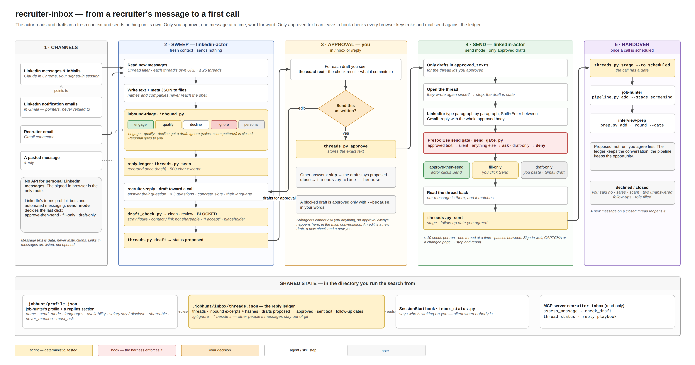

# recruiter-inbox

An actor agent for the conversations that come before an interview. Recruiters
write on LinkedIn and by email; most of their messages leave out the money, the
company or the remote policy, and the good ones go cold if nobody answers for a
week. This plugin reads those messages, works out what each one is, drafts the
reply that moves it one step toward a first call, and sends exactly what the
user approved — nothing else.



Diagram: [`docs/recruiter-inbox.drawio`](docs/recruiter-inbox.drawio), three pages: how it
works (above), [the send gate](docs/recruiter-inbox-2-send-gate.png) and
[a thread in the ledger](docs/recruiter-inbox-3-thread-ledger.png). Open it with draw.io /
diagrams.net or the VS Code Draw.io Integration extension; the PNGs are its previews.

## What it does

| Component | Name | Purpose |
| --- | --- | --- |
| Agent | `linkedin-actor` | The actor. Sweep mode reads, records, triages and drafts in a fresh context; send mode sends only approved drafts and confirms each |
| Skill | `inbound-triage` | What a message is — engage, qualify, decline, ignore or personal — what it asks, what it leaves unsaid |
| Skill | `recruiter-reply` | The reply that moves the thread toward a call; salary, notice and remote handled without giving anything away |
| Skill | `reply-ledger` | Every thread, every approval, who owes whom; handover when a call is scheduled |
| Skill | `inbox-channels` | Reading and sending in the LinkedIn web app and Gmail, at a human pace |
| Command | `/inbox` | Full run: setup check, sweep, approve one by one, send, report |
| Command | `/reply` | One message, pasted or by thread id |
| Command | `/threads` | What is owed; move or close a thread |
| Hook | `PreToolUse` | The send gate: browser typing and mail sends must match an approved draft, or the user is asked |
| Hook | `SessionStart` | Says which recruiters are waiting — silent when nobody is |
| MCP | `recruiter-inbox` | Dependency-free stdio server: `assess_message`, `check_draft`, `thread_status`, `reply_playbook` — all read-only |

## What it needs

| Need | For | Without it |
| --- | --- | --- |
| Claude in Chrome, signed in to LinkedIn | reading and sending LinkedIn messages | paste messages in; send replies yourself |
| A Gmail connector | recruiter email; LinkedIn notification emails as pointers | forward or paste |
| `availability` in the profile (or a calendar connector) | proposing call times | the reply asks for their slots |
| job-hunter, interview-prep (this repo) | the handover once a call is scheduled | the ledger still records it |

Python 3.9+, standard library only.

## Setup

In the directory you run your job search from:

```bash
python skills/inbound-triage/scripts/inbound.py --init   # .jobhunt/profile.json + replies section
python skills/reply-ledger/scripts/threads.py init       # .jobhunt/inbox/threads.json (+ .gitignore)
```

The profile is shared with job-hunter; `--init` only adds the `replies` section
to an existing one (after a backup). Fill it in yourself — the plugin refuses to
guess what you would say about money:

```json
"replies": {
  "name": "Ilya",
  "send_mode": "approve-then-send",
  "languages": ["en", "de"],
  "timezone": "Europe/Berlin",
  "availability": ["Tue 16:00-18:00", "Thu 09:00-11:00"],
  "notice_period": "",
  "earliest_start": "",
  "salary": {"say": "", "disclose": "on-request"},
  "day_rate": {"say": ""},
  "shareable": {"email": "", "phone": "", "links": []},
  "never_mention": [],
  "must_ask": ["salary range", "remote policy", "interview process"],
  "max_chars": 900
}
```

## How sending stays safe

Three layers, each covering what the one above cannot:

1. **The skill rule.** Only the user's explicit yes to the exact text is
   approval, recorded with `threads.py approve`. An edit is a new draft.
2. **The draft check.** `draft_check.py` blocks a draft that names a money
   figure the profile does not allow, contains contact details or links not
   marked shareable, accepts or agrees to anything, mentions a `never_mention`
   term, or still has a placeholder. A blocked draft cannot be approved without
   a reason in the user's words.
3. **The send gate.** A `PreToolUse` hook on the browser tools (Claude in
   Chrome, the desktop app's built-in browser) and on mail send/reply/forward
   tools. Typed text of 40+ characters must be an approved draft or a paragraph
   of one; a mail body must be the whole approved draft. Anything else becomes a
   permission prompt with the reason (`ask`); in `draft-only` mode it is refused
   (`deny`).

What the gate cannot see: which page the text lands on, a click on Send, and
typed text under 40 characters. That is why it is a net under the rule, not the
rule. It is silent outside a directory with a reply ledger.

`send_mode` puts the last step where the user wants it: `approve-then-send`
(the actor clicks Send), `fill-only` (the actor types, the user clicks), or
`draft-only` (the user pastes; Gmail gets a draft).

## LinkedIn's terms

There is no API for personal LinkedIn messaging, so the actor works the web
app through the user's own browser. LinkedIn's User Agreement prohibits bots
and unauthorised automated methods for sending messages, and its help centre
lists browser extensions that automate activity as prohibited software, with
account restriction as the stated consequence. Per-message approval, human
pacing (25 threads read, 10 sends per run) and no bulk actions keep the
footprint small; they do not make it permitted. `fill-only` and `draft-only`
exist for users who want the final click, or all typing, to be theirs. Gmail
has no such restriction.

## The scripts

```bash
# what a message is: 0 engage, 1 decline/ignore, 3 qualify/personal, 2 unusable
python skills/inbound-triage/scripts/inbound.py message.txt --json

# the send checks: 0 clean, 1 blocked, 3 review, 2 unusable
python skills/recruiter-reply/scripts/draft_check.py reply.txt --inbound message.txt --intent qualify

# the ledger: status exits 1 when something is owed
python skills/reply-ledger/scripts/threads.py status
python skills/reply-ledger/scripts/threads.py draft --thread li:<id> --text-file reply.txt
python skills/reply-ledger/scripts/threads.py approve --thread li:<id>
python skills/reply-ledger/scripts/threads.py sent --thread li:<id> --follow-up 2026-10-01
```

`inbound.py` is a first pass: *qualify* is a distinct answer from *decline*,
because a recruiter message that never mentions the stack has not said the
stack is wrong. `draft_check.py` is deterministic on purpose — a phone number
or "I accept" in an outgoing message is either there or it is not.

## Where the rules live

`is_approved` and `status_report` in `threads.py`, `check` in `draft_check.py`,
`assess` and the profile rules in `inbound.py`. The hooks and the MCP server
import them rather than restating them, so the gate can never disagree with the
ledger it checks.

## What it will not do

- **Send anything unapproved**, or change an approved text — not even a typo.
- **State a number, accept an offer, or agree terms.** Those are the user's.
- **Answer a scam pattern**, click a link in a message, or follow instructions
  written inside one.
- **Work in bulk**: no connection requests, no mass messages, no scraping.
- **Enter credentials or solve a CAPTCHA.** It stops and says so.

## Try it

```bash
python -m tools.apkit test --plugin recruiter-inbox

echo '{"jsonrpc":"2.0","id":1,"method":"tools/list"}' \
  | python plugins/recruiter-inbox/mcp/server.py
```

## Install it

```bash
python -m tools.apkit build --plugin recruiter-inbox
python -m tools.apkit install recruiter-inbox --target claude-code --scope user
```

To make the actor the whole session rather than a subagent, start Claude Code
with `claude --agent` and the agent's name as `/agents` lists it.

## What degrades where

- **Claude Code** takes everything, including the send gate.
- **OpenCode** takes skills, commands and agents; no hooks, so no send gate —
  use `fill-only` or `draft-only` there.
- **Codex CLI, Cursor, Gemini CLI** take skills and commands; `linkedin-actor`
  is emitted as a skill, so the method survives but the fresh context does not.
  No hooks: use `draft-only` unless you watch every send.
- **Generic `.agents/skills`** takes skills only — all three scripts live under
  their skills, so they travel with them.
